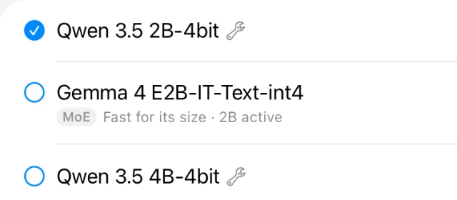

Enigmus runs open-weight language models entirely on device, on iPhone, iPad and Mac, with MLX Swift doing the inference. Until now the loaded model had one client, Enigmus's own chat. Coding agents, scripts and other chat apps speak the OpenAI API instead, and that usually means a cloud endpoint, where every prompt and every file an agent reads lands on someone else's server. Version 1.3.0, out now on all three platforms, puts that API inside the app as a small HTTP server. The same tools can now run against the device's own model, and by default nothing leaves the device.

## An OpenAI-compatible API on localhost

The server has its own page, LLM Server, opened from a row at the top of the chats list and shown in the screenshot at the top. Its first control is an Active switch. Turning it on starts a listener at `http://127.0.0.1:31415/v1`, and anything that takes an OpenAI base URL can be pointed at it. On a Mac with the bundled model loaded:

```sh
curl -s http://127.0.0.1:31415/v1/chat/completions \
  -H 'Content-Type: application/json' \
  -d '{
    "model": "bundled/Qwen3.5-0.8B-4bit",
    "messages": [{"role": "user",
      "content": "Name the capital of France in one word."}],
    "max_tokens": 20
  }'
```

The reply is a standard `chat.completion` object, with "Paris" in `choices[0].message.content`. With `"stream": true` the same answer arrives as server-sent events.

Nothing is loaded twice. The server and the chat share the one model in memory, and that model writes one reply at a time, so a request that arrives mid-reply queues. It waits up to 30 seconds for its turn and gets a 429 after that.

The official `openai` package works against the server unchanged, and so do coding agents such as opencode and Pi. No API key is checked, so a client that insists on one can be given any string. With a tool-calling model loaded (more on those below), an agent reads and edits a project on the Mac's own model, and none of the code leaves the machine.

Not all of the OpenAI API is there. A request for several answers at once (`n` above 1), for JSON-only output (`response_format`) or for `logprobs` gets a 400 that names the field. That is deliberate: accepting the field and ignoring it would hand the client something it did not ask for.

The switch is off at every launch. On iPhone and iPad the server also runs only in the foreground: iOS gives it no background time, so locking the screen or switching apps pauses it. The page logs each request as it arrives. The log is kept in memory only, and prompt text stays out of it unless the user turns that on.

## Serving the web UI to other devices

<WebUISketch
  src="/images/enigmus-1-3-web-chat"
  alt="The Enigmus web UI in a phone-width browser, served by the app: the bundled Qwen 3.5 0.8B model selected at the top, the prompt Write a haiku about autumn rain, a three-line reply, and token counts of 20 in and 22 out"
  address="http://192.168.1.20:31415"
  className="mb-10 mt-2"
/>

The same port also serves a web UI, the chat page on the iPhone in the sketch above. It is a set of static files bundled in Enigmus, it fetches nothing from the internet, and it talks to the `/v1` API like any other client. On a Mac, one button opens it in the default browser.

By default the server listens on `127.0.0.1`, so only apps on the same device can reach it. Allow Network Access rebinds it to `0.0.0.0`, which opens it to the local network. The page then shows the device's Wi-Fi address and a QR code for the web UI, so a phone can scan the code and chat with the model on a Mac.

## Qwen models from 2B up can call tools



Tool calls are what let an agent act and not only answer. The client lists its tools in the request's `tools` field, and the model can reply with a `tool_calls` entry, such as "read this file", in place of text. The client runs the tool and sends the result back in the next request. Enigmus serves tools on Qwen 3.5 from the 2B size up and on every Qwen 3.6 model. The install screen marks those models with a wrench, as in the rows above, and the 9B and larger ones also sit under a new Coding category.

Small models are careless with the call syntax. The 2B, for one, often writes a tag such as `<parameter=query` and drops the closing `>`, and the MLX parser rejects the whole call. Enigmus closes the tag and parses the call once more before giving up on it. The bundled 0.8B is too small to call tools at all, and Gemma 4 is not served with tools in Enigmus yet.

## Also in 1.3

- **Message text** now follows the system text size, set in iOS Settings or with Command-plus and Command-minus on Mac. The app's own font size setting is gone. Toolbars and settings keep their layout.
- **Shortcuts open the app.** "Ask Enigmus" and the new "Start an Enigmus chat" now answer in a saved chat instead of in the background.
- **The thinking toggle** is now a two-option menu that says what each mode costs.
- **The model picker** closes once the new model has loaded.
- **Any installed model** can be benchmarked again from the models list.
- **On Mac**, the model and long conversations get half a gigabyte more memory.
- **Fixes:** deleting a chat now deletes its messages too, and messages orphaned by earlier deletes are cleared at launch. A model load no longer leaves about 80 MB behind. The onboarding screens lay out correctly on iPad.

## Getting it

Enigmus 1.3.0 is a free update for iPhone (13 or newer), iPad (M1 or newer) and Mac (Apple silicon).

[Enigmus on the App Store, for iPhone and iPad](https://apps.apple.com/us/app/enigmus/id6771532268)

[Enigmus on the Mac App Store](https://apps.apple.com/us/app/enigmus/id6771532268?platform=mac)
